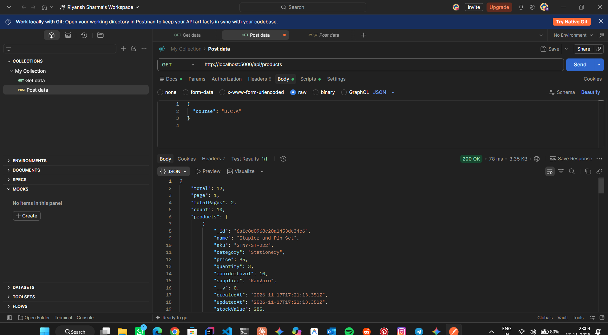
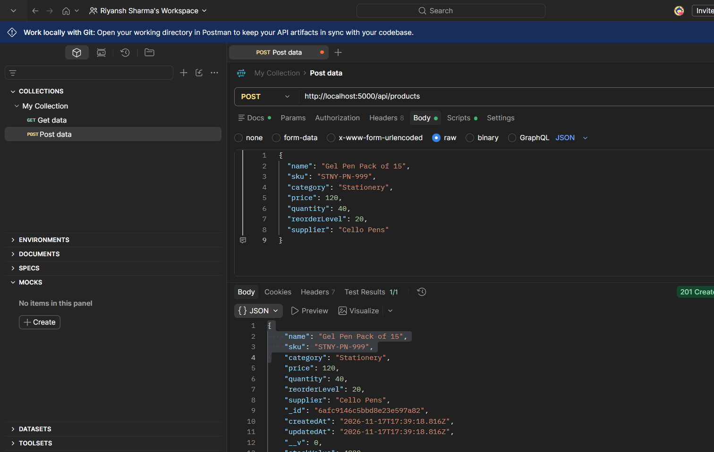
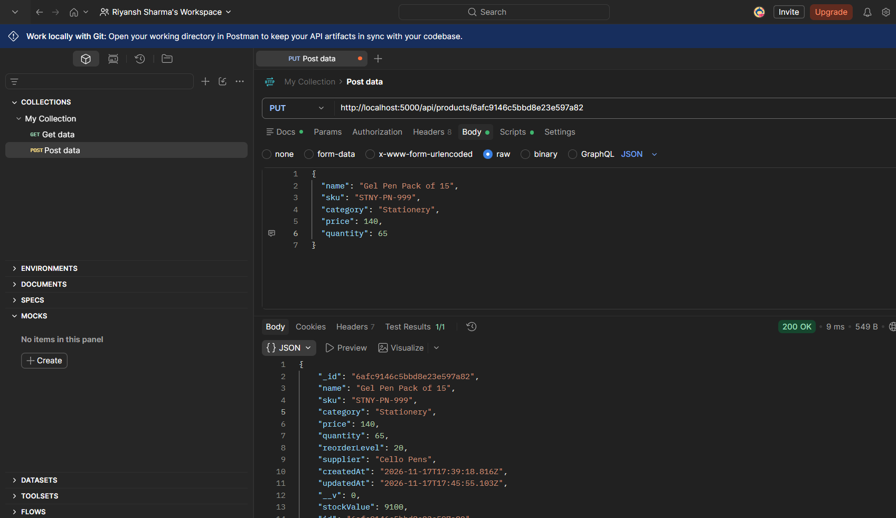
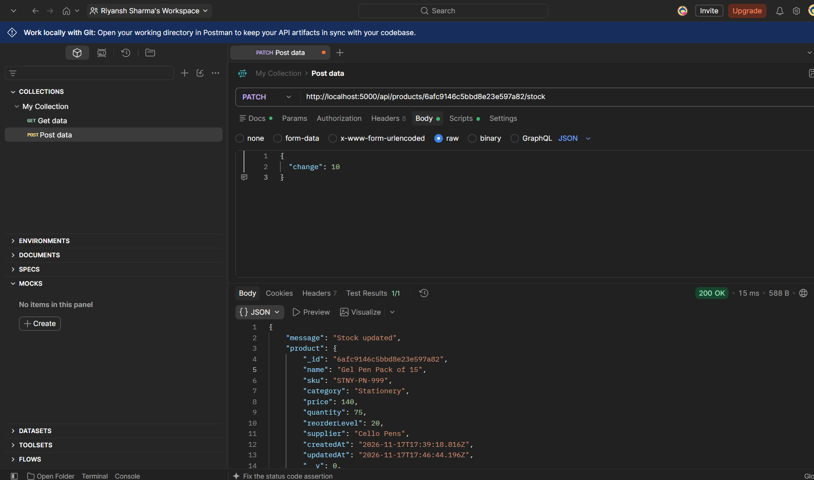
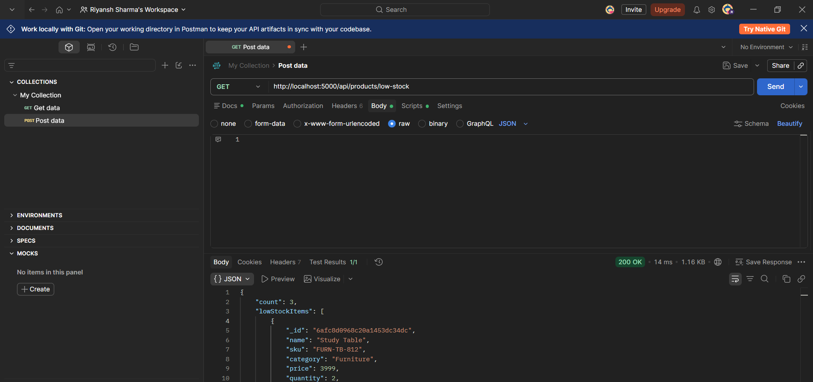
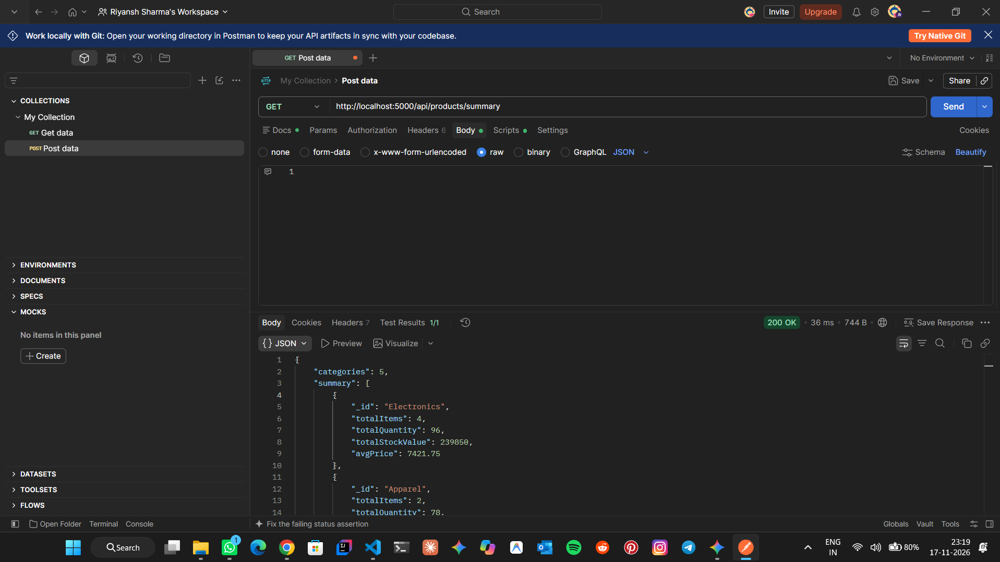
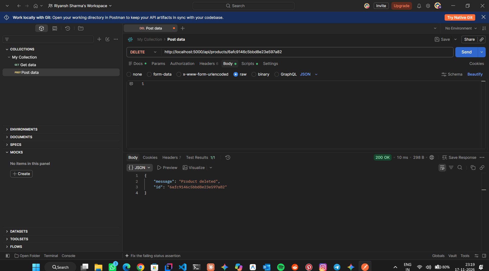

# Assignment 3: Inventory and Data Management System

A RESTful backend API for inventory and warehouse product catalogue management built with **Node.js**, **Express.js**, **Mongoose**, and **MongoDB**.

---

## 📋 Table of Contents
- [Assignment Overview](#-assignment-overview)
- [Technology Stack](#-technology-stack)
- [Project Architecture](#-project-architecture)
- [Features & Requirements](#-features--requirements)
- [Installation & Setup](#-installation--setup)
- [API Reference](#-api-reference)
  - [1. Create Product](#1-create-product)
  - [2. Get All Products (Filtering, Sorting, Pagination)](#2-get-all-products)
  - [3. Get Low-Stock Alert Report](#3-get-low-stock-alert-report)
  - [4. Category-Wise Inventory Summary (Aggregation)](#4-category-wise-inventory-summary)
  - [5. Get Single Product by ID](#5-get-single-product-by-id)
  - [6. Update Product Details](#6-update-product-details)
  - [7. Stock Adjustment (Safe Restock/Sale)](#7-stock-adjustment)
  - [8. Delete Product](#8-delete-product)
- [Error Handling & Validation](#-error-handling--validation)

---

## 🎯 Assignment Overview
The **Inventory and Data Management System** backend enables a warehouse/store to:
- Maintain a structured product catalogue with schema-level validation.
- Execute complete CRUD operations.
- Apply query-string based filtering, multi-field searching, sorting, and pagination.
- Run MongoDB aggregation pipelines to calculate category-wise metrics.
- Monitor low stock items based on reorder thresholds.
- Perform safe inventory adjustments preventing negative stock levels.

---

## 🛠 Technology Stack
- **Node.js** – Server runtime environment
- **Express.js** – Web application framework and routing
- **MongoDB** – NoSQL database
- **Mongoose** – Object Data Modeling (ODM) for schema validation and queries
- **dotenv** – Environment variable management

---

## 📁 Project Architecture
```text
WEB-DEV-LAB-3/
├── .env.example              # Environment variables template
├── .gitignore                # Git ignore configuration
├── package.json              # Project dependencies and scripts
├── README.md                 # Complete API documentation
├── seed.js                   # Database seeder with sample products
├── server.js                 # Server entry point & DB connection
└── src/
    ├── app.js                # Express app configuration & middleware
    ├── config/
    │   └── db.js             # Mongoose MongoDB connection
    ├── controllers/
    │   └── productController.js # Route logic and aggregations
    ├── middleware/
    │   └── errorHandler.js   # Centralized error handler
    ├── models/
    │   └── Product.js        # Mongoose schema, validation & virtuals
    └── routes/
        └── productRoutes.js  # RESTful API route declarations
```

---

## 🚀 Installation & Setup

### 1. Prerequisites
- [Node.js](https://nodejs.org/) (v16 or higher)
- [MongoDB](https://www.mongodb.com/) running locally or a MongoDB Atlas URI

### 2. Clone the Repository
```bash
git clone https://github.com/sharmariyansh2362/WEB-DEV-LAB-3.git
cd WEB-DEV-LAB-3
```

### 3. Install Dependencies
```bash
npm install
```

### 4. Configure Environment Variables
Create a `.env` file in the root directory (or copy from `.env.example`):
```env
PORT=5000
MONGODB_URI=mongodb://localhost:27017/inventory_db
NODE_ENV=development
```

### 5. Seed Sample Data (Optional)
```bash
npm run seed
```

### 6. Start the Server
```bash
# Production mode
npm start

# Development mode (with live watch)
npm run dev
```
The server will start on `http://localhost:5000`.

---

## 📖 API Reference

### 1. Create Product
Creates a new product document in the inventory.

- **Route:** `POST /api/products`
- **Headers:** `Content-Type: application/json`
- **Status:** `201 Created`

**Request Body:**
```json
{
  "name": "Gel Pen Pack of 15",
  "sku": "STNY-PN-713",
  "category": "Stationery",
  "price": 120,
  "quantity": 40,
  "reorderLevel": 20,
  "supplier": "Cello Pens"
}
```

**Response (201 Created):**
```json
{
  "_id": "6a547727f6123427d6e61d7c",
  "name": "Gel Pen Pack of 15",
  "sku": "STNY-PN-713",
  "category": "Stationery",
  "price": 120,
  "quantity": 40,
  "reorderLevel": 20,
  "supplier": "Cello Pens",
  "createdAt": "2026-07-13T05:27:03.054Z",
  "updatedAt": "2026-07-13T05:27:03.054Z",
  "__v": 0,
  "stockValue": 4800,
  "id": "6a547727f6123427d6e61d7c"
}
```

---

### 2. Get All Products
Fetches paginated list of products with query parameters for filtering and sorting.

- **Route:** `GET /api/products`
- **Status:** `200 OK`
- **Query Parameters:**
  - `page`: Page number (default: `1`)
  - `limit`: Number of items per page (default: `10`)
  - `category`: Filter by category name (e.g. `Furniture`)
  - `supplier`: Filter by supplier name
  - `search`: Case-insensitive search on `name` or `sku`
  - `minPrice`: Minimum price filter
  - `maxPrice`: Maximum price filter
  - `sortBy`: Field to sort by (e.g. `price`, `quantity`, `createdAt`)
  - `order`: `asc` or `desc` (default: `desc`)

**Example Request:**
```http
GET /api/products?page=1&limit=10&sortBy=price&order=desc
```

**Response (200 OK):**
```json
{
  "total": 12,
  "page": 1,
  "totalPages": 2,
  "count": 10,
  "products": [
    {
      "_id": "6a54767af6123427d6e61d76",
      "name": "Study Table",
      "sku": "FURN-TB-812",
      "category": "Furniture",
      "price": 3999,
      "quantity": 2,
      "reorderLevel": 4,
      "supplier": "IKEA India",
      "createdAt": "2026-07-13T05:24:10.351Z",
      "updatedAt": "2026-07-13T05:24:10.351Z",
      "__v": 0,
      "stockValue": 7998,
      "id": "6a54767af6123427d6e61d76"
    }
  ]
}
```

---

### 3. Get Low-Stock Alert Report
Retrieves all products whose current `quantity` is less than or equal to their `reorderLevel`.

- **Route:** `GET /api/products/low-stock`
- **Status:** `200 OK`

**Response (200 OK):**
```json
{
  "count": 4,
  "lowStockItems": [
    {
      "_id": "6a54767af6123427d6e61d76",
      "name": "Study Table",
      "sku": "FURN-TB-812",
      "category": "Furniture",
      "price": 3999,
      "quantity": 2,
      "reorderLevel": 4,
      "supplier": "IKEA India",
      "createdAt": "2026-07-13T05:24:10.351Z",
      "updatedAt": "2026-07-13T05:24:10.351Z",
      "__v": 0,
      "stockValue": 7998,
      "id": "6a54767af6123427d6e61d76"
    }
  ]
}
```

---

### 4. Category-Wise Inventory Summary (Aggregation)
Runs a MongoDB aggregation pipeline to compute summary statistics per product category.

- **Route:** `GET /api/products/summary`
- **Status:** `200 OK`

**Response (200 OK):**
```json
{
  "categories": 5,
  "summary": [
    {
      "_id": "Electronics",
      "totalItems": 4,
      "totalQuantity": 96,
      "totalStockValue": 343904,
      "avgPrice": 5636.5
    },
    {
      "_id": "Apparel",
      "totalItems": 2,
      "totalQuantity": 78,
      "totalStockValue": 75522,
      "avgPrice": 1399
    }
  ]
}
```

---

### 5. Get Single Product by ID
- **Route:** `GET /api/products/:id`
- **Status:** `200 OK`

---

### 6. Update Product Details
Updates product attributes with schema validation.

- **Route:** `PUT /api/products/:id`
- **Headers:** `Content-Type: application/json`
- **Status:** `200 OK`

**Request Body:**
```json
{
  "name": "Gel Pen Pack of 15",
  "sku": "STNY-PN-713",
  "category": "Stationery",
  "price": 140,
  "quantity": 60
}
```

**Response (200 OK):**
```json
{
  "_id": "6a547727f6123427d6e61d7c",
  "name": "Gel Pen Pack of 15",
  "sku": "STNY-PN-713",
  "category": "Stationery",
  "price": 140,
  "quantity": 60,
  "reorderLevel": 20,
  "supplier": "Cello Pens",
  "createdAt": "2026-07-13T05:27:03.054Z",
  "updatedAt": "2026-07-13T05:30:25.913Z",
  "__v": 0,
  "stockValue": 8400,
  "id": "6a547727f6123427d6e61d7c"
}
```

---

### 7. Stock Adjustment (Safe Restock/Sale)
Safely increments or decrements current stock. Prevents stock from falling below 0.

- **Route:** `PATCH /api/products/:id/stock`
- **Headers:** `Content-Type: application/json`
- **Status:** `200 OK` (or `400 Bad Request` if insufficient stock)

**Request Body:**
```json
{
  "change": 10
}
```
*(Use positive values to restock, negative values like `-5` for sales/dispatches)*

**Response (200 OK):**
```json
{
  "message": "Stock updated",
  "product": {
    "_id": "6a54767af6123427d6e61d76",
    "name": "Study Table",
    "sku": "FURN-TB-812",
    "category": "Furniture",
    "price": 3999,
    "quantity": 12,
    "reorderLevel": 4,
    "supplier": "IKEA India",
    "createdAt": "2026-07-13T05:24:10.351Z",
    "updatedAt": "2026-07-13T05:35:24.419Z",
    "__v": 0,
    "stockValue": 47988,
    "id": "6a54767af6123427d6e61d76"
  }
}
```

---

### 8. Delete Product
Removes a product from the database.

- **Route:** `DELETE /api/products/:id`
- **Status:** `200 OK`

**Response (200 OK):**
```json
{
  "message": "Product deleted",
  "id": "6a547727f6123427d6e61d7c"
}
```

---

## 🛡 Error Handling & Validation
The application uses centralized error-handling middleware (`src/middleware/errorHandler.js`):
- **400 Bad Request:** Field validation errors, invalid stock adjustments, or duplicate unique keys (`sku`).
- **404 Not Found:** Invalid or non-existent document IDs.
- **500 Internal Server Error:** Unexpected server-side issues.
## Postman API Output Screenshots

### 1. Get All Products (`GET /api/products`)


### 2. Create Product (`POST /api/products`)


### 3. Update Product (`PUT /api/products/:id`)


### 4. Stock Adjustment (`PATCH /api/products/:id/stock`)


### 5. Low-Stock Alert Report (`GET /api/products/low-stock`)


### 6. Category-wise Inventory Summary (`GET /api/products/summary`)


### 7. Delete Product (`DELETE /api/products/:id`)
